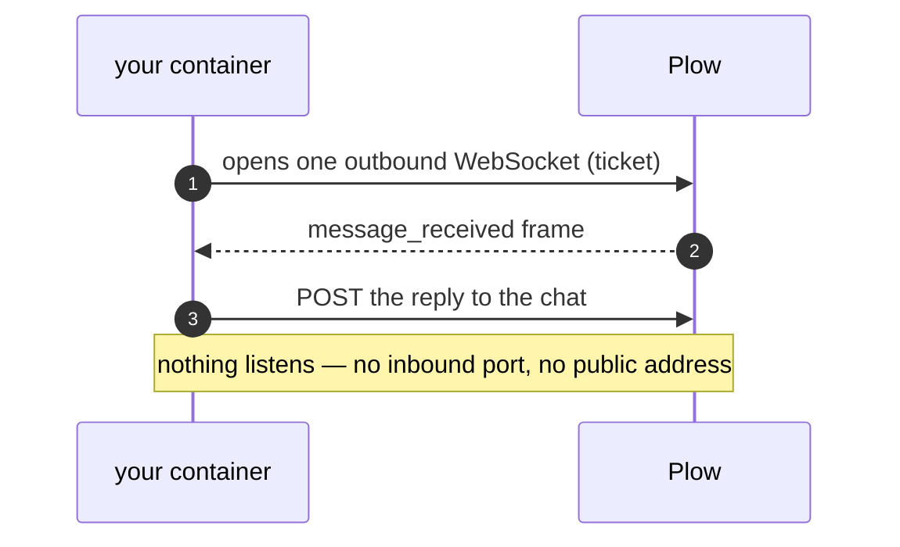
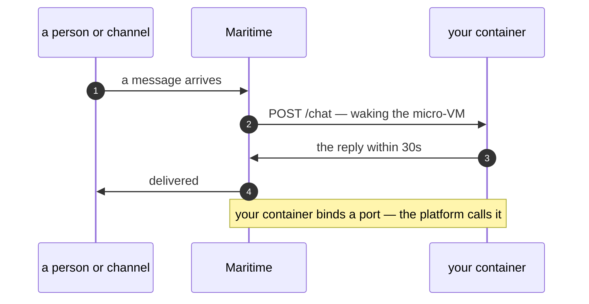
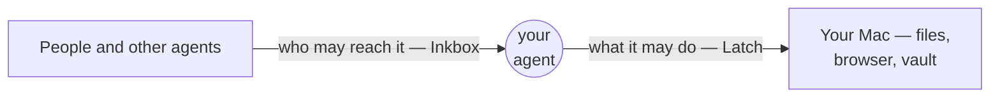
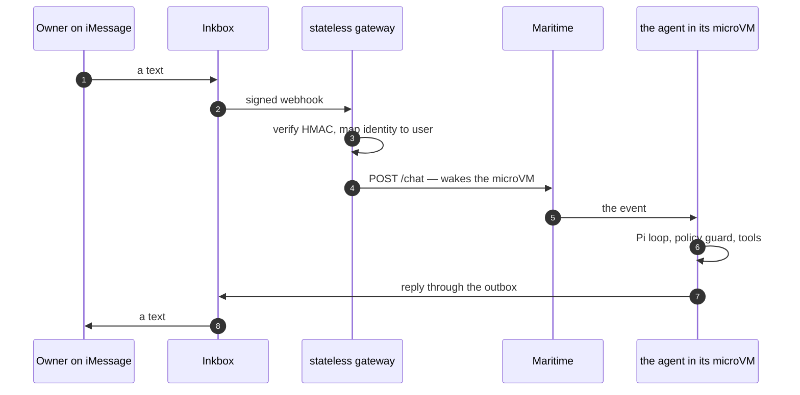
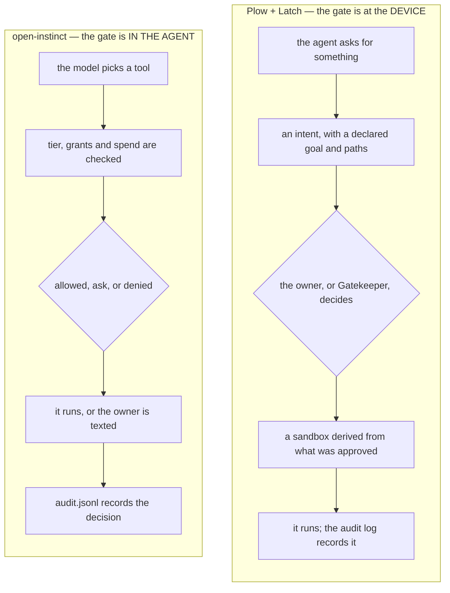
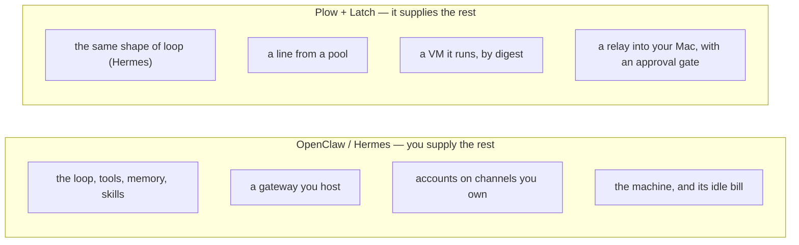
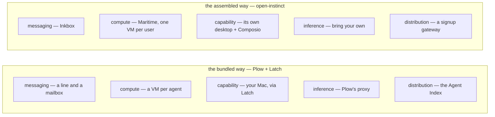

# Comparisons

Plow and Latch against three neighbours, across purpose, technology, UX and
users. Written from the public pages fetched **2026-10-13** and this repo's own
probing — so treat vendor feature claims as claims, and note that
`open-instinct` is v0.1 and describes itself as beta.

The useful frame is **which layer** each thing occupies, because none of these
are direct substitutes.

| | Inkbox | Maritime | Open Instinct | Plow + Latch |
|---|---|---|---|---|
| layer | identity & messaging | agent compute | an assembled application | platform + device access |
| shape | cloud service | cloud infra | MIT repo you run | hosted platform + Mac app |

---

## Feature matrix

Every axis the three neighbours differ on, in one grid.

**Legend:** `✓` has it · `~` partial, indirect, or by composition · `–` not
offered · `?` not documented publicly. Vendor columns come from marketing pages
fetched 2026-10-13, so a `–` can mean "not advertised" as easily as "absent";
`open-instinct` is v0.1 and self-described beta.

| | **Plow + Latch** | **Inkbox** | **Maritime** | **open-instinct** |
|---|---|---|---|---|
| **REACH & IDENTITY** | | | | |
| Phone number / iMessage | ✓ a pool line per agent | ✓ | – | ~ via Inkbox |
| Email inbox of its own | ✓ (agent mailbox) | ✓ | – | ~ via Inkbox |
| Inbound internet address | – agent dials out only | ✓ tunnel | ~ inside its VM | ~ via Inkbox |
| Agent-to-agent (A2A) | ~ peer agents in a chat | ✓ explicit | – | ✓ over Inkbox |
| Cross-channel memory (one person) | ~ per-chat sessions | ✓ the point | – | ✓ |
| Per-channel access control | ~ grant + per-chat trust | ✓ who can reach it | – | ✓ six tiers |
| Shared org memory (contacts, notes) | – | ✓ directory + searchable notes | – | ~ `contacts.json` + `MEMORY.md` |
| Agent-to-agent protocol | ~ peer agents in a chat | ✓ **A2A 1.0**, tasks, contexts, Agent Cards | – | ✓ **OIP/1 over A2A** — typed intents |
| **COMPUTE** | | | | |
| Hosted VM per agent | ✓ | – no compute | ✓ | ✓ on Maritime |
| One VM per *end user* | ~ per line | – | ✓ the pitch | ✓ one agent per person |
| Persistent disk / state | ✓ state volume | – | ✓ | ✓ |
| Snapshot-sleep, fast wake | ? | – | ✓ 0.5s boot / 0.6s wake | ~ via Maritime |
| Own headful desktop | – | – | ✓ watch or take over | ✓ via Maritime |
| Hardware-level isolation | ~ VM per agent | – | ✓ micro-VM, own kernel | ✓ via Maritime |
| **CAPABILITY** | | | | |
| Reaches *your* real Mac | ✓ Latch | – | – | – |
| Browser automation | ✓ supervised, anti-detection | – | ✓ headful Chrome | ✓ desktop |
| Files & commands | ✓ Latch | – | ✓ full VM | ✓ its VM |
| Third-party apps | ~ connectors (gmail, slack) | – | – | ✓ Composio |
| How-to skills / playbooks | ✓ read on demand | – | – | ✓ `skills/` |
| MCP endpoint | ✓ Latch is an MCP server | ✓ listed among SDK/CLI/Skill/MCP | ✓ one MCP, a desktop per user id | ~ consumes MCP |
| **SAFETY & CONTROL** | | | | |
| Per-request approval | ✓ intents | – access control, not per action | – | ✓ policy guard + takeover |
| AI reviewer | ✓ Gatekeeper | – | – | – |
| Sandbox of approved capabilities | ✓ derived profile | – | ✓ the VM | ✓ the VM |
| Vault usable but unreadable | ✓ the owner's logins | – | – | ~ single-use cards |
| Secret store the agent itself reads | – | ✓ zero-knowledge vault, per-secret grants | ~ encrypted env vars | ~ `secrets/`, mode 0600 |
| Audit log | ✓ | – | – | ✓ `audit.jsonl`, readable in chat |
| Payments / spend limits | ✓ threshold + approval link | – | – | ✓ Stripe Link + spend policy |
| **MODEL** | | | | |
| Model supplied | ✓ proxy + allowlist | – | ✓ per-agent token, prepaid AI credits, list price | – BYO (defaults to Claude) |
| **ECONOMICS** | | | | |
| Pricing shape | account credits: chat, inference, lines | usage + overage limit | **flat ~$1/machine/month**, nothing metered | the sum of its parts |
| Scarce resource | credits and lines | messages and numbers | awake memory ("running at once") | whatever you allocate |
| **OPERATE & DISTRIBUTE** | | | | |
| Human interface | phone, email, dashboard, marketplace | console, CLI, SDK, MCP | dashboard, CLI, SDK, MCP | CLI + a signup gateway |
| Multi-user provisioning | ~ lines, signup phrases | ~ identities on demand | ✓ per your user | ✓ gateway page |
| Marketplace for agents | ✓ Agent Index | – | – | – |
| Your own image | ✓ pulled by digest | – | ✓ | ✓ |
| Licensed / self-hosted | hosted; your image | commercial | commercial | ✓ MIT |
| **THE PLATFORM CONTRACT** | | | | |
| Who opens the connection | **the agent dials out** (one socket, no inbound) | n/a | **the platform posts to you** (bind a port) | Maritime's for the agent, Inkbox's webhooks for the door |
| The thing you must implement | read `PLOW_API_BASE`, send the bearer, `CMD` is PID 1 | handle webhooks | `GET /health` → 200, `POST /chat` → reply within 30s, state under `/data` | both of the above |

---

## Two contracts: dial out, or listen

The deepest split between Plow and Maritime is not features — it is **which way the
connection opens**, and it decides what kind of product each suits.

- **Plow: the agent dials out.** Nothing listens; a grant-scoped WebSocket carries
  inbound frames and every reply is an HTTP POST. That is why a phone line works at
  all (there is no address to post to), why the contract is three lines long, and why
  a Mac can be reached through the relay — everything is outbound. The cost: the agent
  is a **client**, so anything that wants to *call* it needs a channel Plow provides
  (a line, a relay). No public URL, by design.
- **Maritime: the platform posts to you.** Your container binds `0.0.0.0:$PORT`,
  answers `GET /health` and `POST /chat` inside 30 seconds, keeps state in `/data`, and
  the platform wakes the micro-VM and delivers. Four doors reach the same
  `POST /chat`: the dashboard, the CLI, the REST API, and channels like Telegram. That
  makes an agent a **service** — and it is why `newChatPolicy: spawn` can give every
  new person their own agent, which is the one-agent-per-customer pattern a product
  needs.

Neither is better; they are the two halves of "how does a message find the agent".
One consequence worth naming: **timers inside a sleeping Maritime agent do not fire**,
so scheduled work must live in the platform's triggers — the mirror image of Plow,
where the agent holds its own socket and runs its own loop.

---

## Latch vs Inkbox

Both are "an agent needs more than intelligence" products, and they are **the
two halves of one trust boundary, from opposite sides.**

- **Inkbox** gives an agent **reach into the world**: its own email inbox, phone
  and iMessage, an internet address (a tunnel), and an Agent2Agent endpoint — all
  under one identity. Email, texts and calls with the same person stay joined, so
  the agent keeps memory of *the person*, not the thread.
- **Latch** gives *the world's* agent **reach into your Mac**: files, commands,
  AppleScript, a real logged-in browser, and a vault it can use but not read.

| axis | Latch | Inkbox |
|---|---|---|
| **purpose** | let an agent *do* things on your machine, safely | let people and other agents *reach* your agent |
| **direction** | agent → your stuff (outbound capability) | world → agent (inbound reach) |
| **technology** | a Mac app: local MCP server, reached through Plow's relay | a cloud service: mailboxes, numbers, tunnel, A2A wire |
| **permission model** | per-request *intents* — approval, a capability-derived sandbox, an audit log, Gatekeeper as an optional AI reviewer | per-agent, per-channel *access control* — who may reach it on email / phone / iMessage / A2A |
| **the secrets** | a vault your agent may use and never read | the identity itself: the mailbox and number *are* the credential |
| **UX** | approval dialogs on your Mac; rules and audit in the app | a console (create an identity in seconds), a CLI/SDK/MCP/Skill |
| **who it's for** | an owner who wants their *own* machine used | a developer who needs their agent addressable |
| **where it runs** | your laptop; nothing listens publicly | their cloud; the Mac dials out |

**Overlap worth noting:** both end up as "agent identity + a policy in front of
capability", and both integrate with any harness. An agent can plausibly want
both — which is exactly what `open-instinct` does below: Inkbox for the phone
line, and something else for the computer. Plow pairs its own lines with Latch,
so it supplies the pair itself.

**What Inkbox's docs actually cover**, which the one-line "identity" framing hides:
an identity is a handle owning **exactly one mailbox and one tunnel**, plus an
optional single phone number (bound for life), optional iMessage, Slack, A2A, and
per-secret vault access. On top of that sit mail (drafts, threads, search, IMAP/SMTP,
custom domains, imports), phone (calls, SMS/MMS, transcripts, a **hosted Voice AI**
that answers calls with no webhook of your own, media streams for voice agents,
10DLC), iMessage (a dedicated line or a **shared service line**, tapbacks, groups,
an agent avatar, and a router number humans text to *connect*), Slack (history,
search, task streams), A2A 1.0 (Agent Cards, tasks, contexts, contact rules,
invitations, directories), an org-wide **contact directory with correspondence
memory**, org-wide **notes** with per-identity access control, **tunnels**
(HTTP/WebSocket/raw-TCP, passthrough TLS), and **agent self-signup** — an agent can
register itself with no account and no key.

So the two products differ in kind, not just in direction: Inkbox is a **comms and
coordination platform** with a secrets store; Latch is a **device-consent layer**.
**Both have a "vault", and they are not the same object:** Inkbox's holds an
organization's secrets *for the agent to read*; Latch's holds the human's logins *for
the agent to use and never read*.

---

## Plow vs Maritime

Both host agents in VMs. They sell **different units**.

- **Maritime** sells **machines**: a Firecracker micro-VM per *end user*,
  on bare metal, with a persistent disk — new in 0.5s, and a sleeping one back in
  0.6s because it snapshots the guest to disk and maps the snapshot back on
  demand, so a parked agent costs only storage. Inside: a headful Linux desktop
  that opens a browser and clicks, which you can watch or take over. It also
  offers the same as **one MCP** ("a desktop per user id") so any MCP client —
  Cursor, Claude Code, your own agent — can drive a computer.
- **Plow** sells **a textable agent**: a phone line and an email line, a model
  proxy, the Latch path to *your* Mac, payments, and a marketplace that publishes
  agents to other people.

| axis | Plow | Maritime |
|---|---|---|
| **unit of tenancy** | one agent per phone line, for you | one VM per *your user* — "give each of your users their own VM, forever" |
| **the artifact** | your public image, pulled by digest | your image too (`--image ghcr.io/…`), or hosted "Computers" |
| **the "computer"** | *your* Mac, via Latch — the human's real machine | the agent's **own** VM with its own desktop |
| **isolation story** | credential scoping, grants, approval, sandbox | hardware-level: real kernel, micro-VM per user |
| **persistence** | a VM per agent; the docs describe warm-pool VMs holding the image in host cache | the headline: snapshot/restore, files + logins + packages survive sleep |
| **interface** | phone, email, dashboard, marketplace | dashboard, CLI, SDK, one MCP endpoint |
| **audience** | agent builders who want it textable, and end users installing one by text | developers building agent startups (their credits page says so) |
| **model** | Plow's own proxy, fixed allowlist | bring your own; the app above it defaults to Claude |

**The distinction:** Maritime is an **infrastructure layer you would build a
Plow-shaped product on**. In fact the repo below does exactly that — it deploys
onto Maritime. Plow is vertically integrated: it is the line, the inference, the
relay, and the store, bundled.

**What Maritime's docs actually commit to.** An agent is a long-lived program in its
own VM with four things attached: a persistent `/data`, encrypted env vars, a chat
front door, and a framework (any Docker container). Sleep is the economy: an idle
agent is snapshotted, wakes in ~1.1–1.4s on a message, a trigger, a request to a
**public web URL**, or a file/exec call — and *timers inside a sleeping agent do not
fire*, so schedules belong in platform triggers. Channels attach at the **project**
level, and `newChatPolicy: spawn` gives every new sender their own agent instance,
which is the SDK's one-agent-per-customer mechanism. They also run their **own LLM
proxy** (per-agent token, OpenAI-format, prepaid credits at list price) — so Plow and
Maritime both bundle inference, which is easy to miss.

And the pricing is the sharpest thing either says: **flat, nothing metered** — about
$1/machine/month, agents and Computers mixed in the same slot, always-on $20. They
argue directly against metered sandboxes (an always-on 2 GB agent ≈ $60/mo on E2B,
≈ $155/mo idle on LangGraph Platform). The scarce resource is *awake* memory, not
tokens: plans cap "running at once", and sleeping machines are free.

**Plow's counter-position:** its scarce resources are credits and lines, and the
agent holds its own socket, so it can keep a timer, keep a session, and be texted
with no address at all — at the cost of not being callable.

---

## Plow vs open-instinct

This is the closest comparison in *intent* and the furthest apart in *position in
the stack*.

`open-instinct` is **an application assembled from the layer**: a personal agent
you text on iMessage, with its own computer and a trusted network of other
agents. It is explicitly "built on Pi, Inkbox, Maritime and Composio", with a
Stripe Link wallet for payments, MIT-licensed, BYO-keys, nine packages, 837
tests, v0.1.

| axis | Plow (+Latch) | open-instinct |
|---|---|---|
| **purpose** | publish and run textable agents; reach a Mac safely | one person's own agent, running anywhere you like |
| **text UX** | phone line + email line, from a pool | iMessage via Inkbox; `instinct init/dev/chat` on a laptop first |
| **the computer** | your Mac (Latch) — the *human's* machine | the agent's own microVM desktop on Maritime |
| **tools** | Latch skills + connectors | Composio app router ("connect my Notion") |
| **approvals** | Latch intents + Gatekeeper; payment threshold and approval links | a code-level policy guard, desktop takeover for logins/2FA, Stripe Link one-tap card approval |
| **trust tiers** | owner / member / peer, plus per-chat trust | six rings — owner, partner, family, friend, contact, stranger — with plain-English grants |
| **payments** | Plow can release a banking credential under a threshold | the agent never holds the card: it asks for a single-use card for the exact amount, dead after |
| **agent-to-agent** | peer agents in a room; the relay | A2A over Inkbox, with per-tier rules |
| **openness** | hosted; your image, their platform | MIT, self-hostable, every key yours |
| **distribution** | Agent Index listings + signup phrases | a gateway that provisions one agent per person at signup |

**The distinction:** they tell the *same user story* — text a personal agent, it
has a computer, it can talk to your friends' agents — and sit at **opposite ends
of the stack**. Plow *is* the platform (lines, inference, Mac access, payments,
marketplace); open-instinct *uses* platforms and is the proof of what assembling
one costs: five external services and their keys, wired together.

Two differences that are philosophical rather than technical: their computer is
**the agent's own VM**, Plow's is **your actual Mac** — one isolates the agent
from you, the other gives it your context; and their six trust rings are a
richer, code-enforced social model than Plow's owner/member/peer + per-chat
trust.

The assembled path, end to end — this is the whole product, and every hop is
somebody else's service:

**What their docs commit to that the others do not.** `PERMISSIONS.md` is a full
tier × capability table — six tiers against roughly twenty-five capabilities
(`calendar.freebusy`, `email.send`, `purchase`, `computer.use`, `network.ask`, …) —
enforced **twice**: once to hide tools from the model, once in `beforeToolCall` to
block anything that slipped through, with the design note *"prompts leak, the guard
is a function with tests."* Additions worth stealing:

- **The owner is not always the owner.** An email *from the owner's own address*
  resolves to `owner:email` — a **partner**-tier principal, untrusted, with no
  `bash`, files, computer or `email.read`, because a `From` header is forgeable and
  the mail webhook carries no SPF/DKIM/DMARC result. Anything needing the owner's
  say-so is still confirmed by text.
- **Group threads run at the lowest tier present.** Each participant gets their own
  session so a colleague never sees the owner's earlier context, and a bare "yes" in
  a group *never* settles an approval.
- **Spend is a policy, not a boolean**: per-action cap, daily cap, `askAbove`,
  `neverWithoutAsk` (flights, hotels), blocked merchants — and approval texts carry a
  token with careful rules for when a bare "yes" counts.
- **Declines are reported.** A denied request from someone else's agent gets a polite
  refusal *and* one text to the owner, rate-limited to one an hour per conversation.
- **Grants are additive and time-boxed** (`"Sam can book us dinner this week"`), never
  widening past the owner.

Plow's answer to the same problem is different in *where* it sits: Latch enforces at
the **device**, per intent, with a human or Gatekeeper deciding, and the capability
set is derived from the call. open-instinct enforces at the **agent**, in code, from a
social table. Both are structural — neither trusts prose — but one asks a person and
one asks a function.

---

## OpenClaw and Hermes: the layer below, and why they can't just *be* Plow

Plow is easy to mistake for a competitor of these two. It isn't. **Plow's hosted
agent *is* a Hermes agent**: `plow-hermes-agent` boots the Hermes runtime under
s6-overlay with the `plow_chat` plugin pinned, and its own README says so — "a
Plow agent is a Hermes Agent … reachable only through Plow Chat." Latch, for its
part, advertises working with "Claude, Codex, Hermes, OpenClaw, and other
MCP-compatible agents."

So the question answers itself once you see the stack: they are the **loop**, and
Plow is the **platform around the loop**.

- **Hermes** (Nous Research, MIT) — the runtime. A gateway process that connects
  Telegram, Discord, Slack, WhatsApp, Signal and CLI; agent-curated memory, skills
  that write and improve themselves, FTS5 session search, cron with delivery, sub-
  agents, MCP, 40+ tools. Seven terminal backends (local, Docker, SSH, Singularity,
  Modal, Daytona, Vercel Sandbox), two of which hibernate when idle. It also sells a
  bundle — **Nous Portal** covers the model, web search, image generation, TTS and a
  cloud browser under one subscription — which is the same "we provide inference"
  idea as Plow's proxy.
- **OpenClaw** (OpenClaw Foundation, MIT, stewarded by a 501(c)(3); ~392k stars) —
  a local-first assistant with the same shape: a **Gateway** as the local control
  plane, channels (Discord, iMessage, Slack, Teams, Telegram, WhatsApp, 20+ more),
  companion apps and nodes for voice/camera/screen, full system access "or
  sandboxed — your choice", skills and plugins shared through **ClawHub**, and
  **OpenClaw Enterprise** for fleets. Microsoft's Autopilot is built on it. It has
  **no hosted tier and no token** by design.

**Why they can't just do it.** Not a capability gap — a *scope* and *business* one:

- **Neither is a carrier.** They reach messaging platforms whose accounts you
  already hold (a Telegram bot token, a Discord app, a WhatsApp bridge). There is no
  pool of numbers, no signup phrase, no per-line credential, no owner/member roster.
  You *can* get a number — one OpenClaw user did it with Twilio in twenty minutes —
  but then you own the registration, the compliance, the deliverability and the bill.
- **Neither is the runner.** "Runs on your machine, or on Modal/Daytona/Fly" means
  *you* supply the compute account, the credentials, the idle bill, and the uptime.
  Plow's promise is the inverse: give me a digest and I run it.
- **Their gateways are inbound services; Plow's agents are outbound clients.** A
  harness needs a host, a port, and either exposure or a tunnel. Plow's agent dials
  out to a socket and holds no address — which is also why a relay can reach a Mac
  that has no public endpoint.
- **The device gate is yours to build.** Both can act on your machine (OpenClaw is
  explicit: full system access, sandboxing optional, and its showcase includes
  reading and writing a 1Password vault). But the *guarantee* is assembled by you —
  pair senders, sandbox, review skills. Latch is that guarantee as a separate,
  signing, updating app with a reviewer the agent cannot argue with.
- **No payments, no catalog, no metering.** Neither has spend approval, nor a
  marketplace where an agent is installed by texting a phrase.
- **The governance forbids it.** OpenClaw is a foundation project with no paid tier
  and no token; Hermes is MIT. Being the platform means becoming the operator —
  owning numbers and their regulation, paying for idle machines, approving spend,
  running the relay that terminates into people's laptops, and being accountable when
  the agent emails your landlord. That is an ops, legal and billing business, not a
  library.

**The honest counterpoint:** they *can* do all of it, by assembly — OpenClaw plus a
Twilio number; Hermes plus Inkbox's official plugin for a line; either plus Maritime
for the machine and Latch for the Mac. That is exactly what `open-instinct` is. What
neither can do is *be the provider* of every layer at once, and neither is
constituted to charge for it.

---

## The stack, side by side

Same layers, two ways to get them:

| layer | the assembled way (`open-instinct`) | the bundled way (`Plow`) |
|---|---|---|
| identity & messaging | Inkbox | Plow's line pool (+ mailbox) |
| compute | Maritime micro-VM | Plow's VM per agent |
| capability / tools | Composio + the agent's own desktop | **Latch** (the owner's Mac) + connectors |
| loop | Pi | the `plow_chat` plugin, or your own container |
| model | bring your own (default Claude) | Plow's proxy and allowlist |
| payments | Stripe Link | Plow payments |
| distribution | their gateway | the Agent Index |

## Who should use what, and why

**Plow (+ Latch)** — for builders whose interface is a phone.
Use it when people should text the agent with nothing to install, when you want
distribution (a phrase anyone can text to install it), and when the agent needs the
owner's *own* machine. Avoid it when you need inbound HTTP into the agent, or one
isolated machine per end user — Plow is a chat platform that runs your container, not
a general compute platform.

**Latch** — for the Mac owner who wants their machine used, not handed over.
The approval *is* the feature, so it suits someone who would otherwise never let an
agent near their files, browser or passwords. Avoid it off macOS, or when you need
unattended autonomy: every call is an approval unless it has been remembered, and the
sandbox is derived from the approved capabilities rather than tightly fitted.

**Maritime** — for a team shipping an agent product, one machine per customer.
Prompt-based triggers, ~1s wakes, a service contract (`/health`, `/chat`), a public
URL if you want web apps, and flat unmetered pricing. Suits agent startups, voice
agents (an awake VM means no cold start), anything wanting a full Linux desktop — and
Windows or Android later on Dedicated. Avoid it if you wanted a phone number and chat
semantics out of the box, or if you want to host a website.

**Inkbox** — for a team whose agent must be addressable, and share a brain.
The broadest surface here: mail, phone, iMessage, Slack, A2A, tunnels, contacts with
memory, notes, a vault, SDKs, skills, MCP, and agents that can sign themselves up.
Suits support and sales agents living in email and Slack, org fleets wanting shared
contacts/notes, and anyone wanting real A2A (tasks, contexts, contact rules). Avoid it
if you want compute or a device for the agent to act on — it deliberately has neither.

**open-instinct** — for the person who wants the experience *and* the receipt.
MIT, BYO keys, readable, and the most rigorous public policy design of the four. Suits
self-hosters, tinkerers, and anyone learning what a serious personal agent needs; it is
also the cheapest way to see the whole stack assembled and running. Avoid it if you
want someone else to operate it, or do not want to hold five sets of keys.

## Opinions

- **Maritime has the most honest economics.** Flat per-machine pricing with sleeping
  agents is a real answer to "what does an idle agent cost", and their metered-
  competitor comparison is the sharpest argument any of these makes. The trade: agents
  are services there, and a sleeping agent cannot keep a timer.
- **Plow's line is both its moat and its constraint.** Nobody else here hands you a
  world-textable number *with chat semantics attached* — grant, roster, peer agents.
  It also means the agent can't be called: no public URL, by design.
- **Latch is the most differentiated and the most honesty-dependent.** Its value is
  consent, not confinement. Read as a security boundary rather than a consent
  boundary, it will disappoint — and Plow says so itself about the sandbox.
- **The two "vaults" are different products wearing one word.** Inkbox's holds an
  org's secrets *for the agent to read*; Latch's holds a human's logins *for the agent
  to use and never read*. Only one of them is a password manager.
- **open-instinct is the best teacher in this set.** The bare-"yes" approval rules,
  "email from the owner's own address is only a partner", and per-participant sessions
  in a group thread are scar tissue you can read. If you are designing agent trust, read
  `PERMISSIONS.md` before writing your own table.
- **The unsolved problem is scale of small decisions.** Every approval design here ends
  at a human — a threshold, a card, a text. None has an agent-native budget that
  survives hundreds of micro-actions without a person in the loop.
- **They compose more than they compete.** open-instinct *is* Inkbox + Maritime +
  Composio + Link; a Plow-shaped product could sit on Maritime; an Inkbox-identified
  agent could still want Latch. The only head-on overlap is identity and messaging.

## What the comparison says about Plow's position

- **Vertically integrated, and that is the product.** The convenience is real:
  one login, one bill, a line, a model, a Mac path. The cost is that you take
  Plow's choices — its lines, its model allowlist, a Mac-only device path.
- **The novel piece is Latch.** Inkbox deliberately supplies identity, not
  capability; Maritime deliberately supplies a machine, not *your* machine.
  Latch is the only one of the three whose whole point is reaching the machine
  you already use, with a vault the agent can't read.
- **The assembled route buys control.** MIT, self-hosted, your keys, your model,
  your computer — at the price of wiring five services and owning their failure
  modes.
- **They compose more than they compete.** `open-instinct` already uses one of
  these services for each layer; a Plow-shaped product could be built on
  Maritime, and an Inkbox-identified agent could still want Latch.
- **Plow's agent is a Hermes agent, and that is the clearest statement of what Plow
  is.** The runtime is borrowed; the line, the relay, the inference bill, the
  approvals, the payments and the catalog are the product. Nobody here competes with
  Hermes — they *are* Hermes plus a platform, or they assemble their own equivalent.

## Sources

Fetched 2026-10-13. The vendor columns are marketing pages and product docs; the
`open-instinct` column is a v0.1 repository that describes itself as beta.

- Inkbox — <https://inkbox.ai/>, the doc index <https://inkbox.ai/docs/llms.txt>, and
  <https://inkbox.ai/docs/capabilities/identities.md>
- Maritime — <https://maritime.sh/>, <https://maritime.sh/docs/how-it-works> (the mental
  model and pricing shape), <https://maritime.sh/pricing>
- open-instinct — <https://github.com/mariagorskikh/open-instinct>, `docs/ARCHITECTURE.md`
  (building blocks, message flow, safety rules, decisions), `docs/PERMISSIONS.md` (the
  tier × capability table, grants, spend policy, approval rules), `docs/PROTOCOL.md`
  (OIP/1: transport, admission, intents)
- Hermes — <https://github.com/NousResearch/hermes-agent> (the runtime, its seven
  terminal backends, the messaging gateway, Nous Portal)
- OpenClaw — <https://openclaw.ai/> and <https://github.com/openclaw/openclaw> (the
  Gateway, channels, nodes, ClawHub, the foundation's no-hosted-tier position)
- this repo — `docs/PLATFORM.md`, `plow-hermes-agent`'s statement that a Plow agent is
  a Hermes agent under s6, and the live probing behind both
